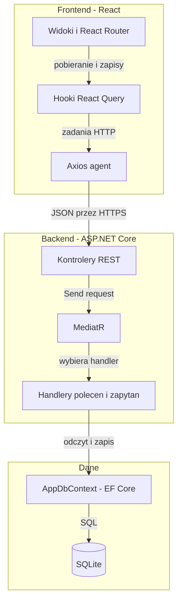
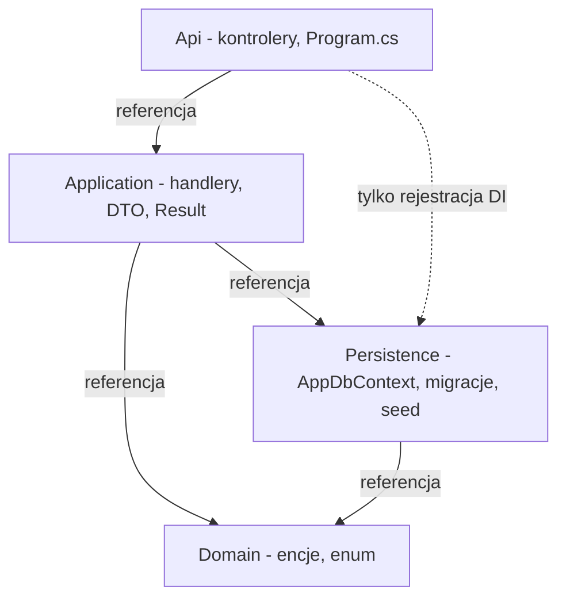
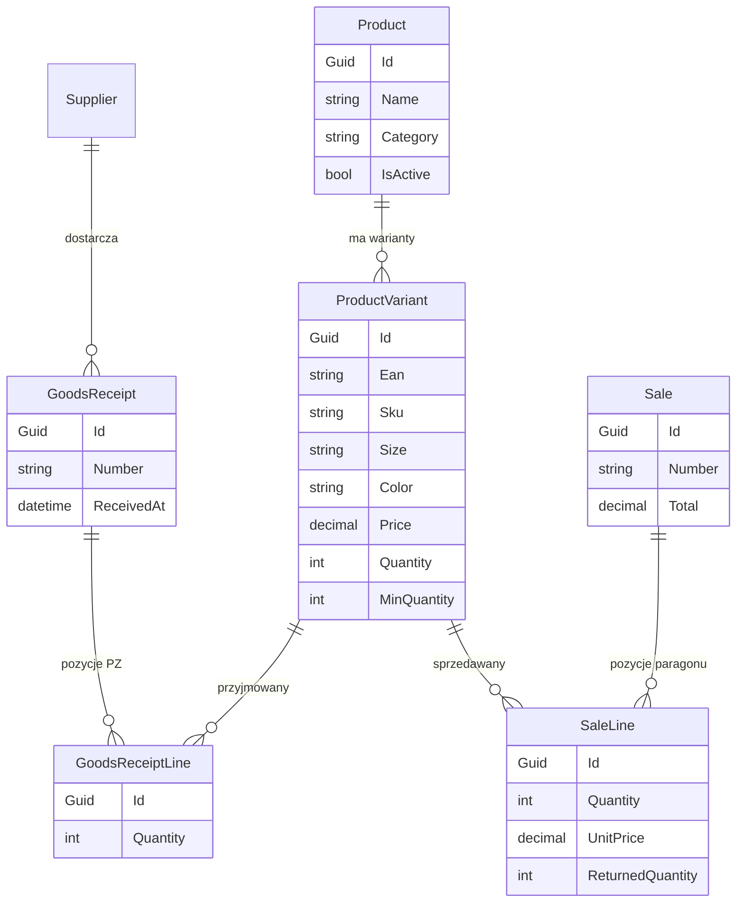
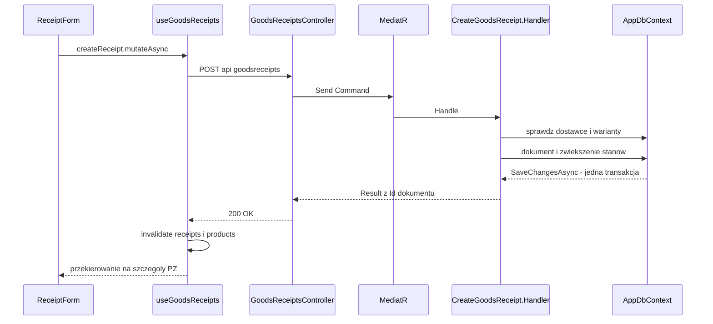

## 1. Zakres prototypu

| Moduł | Status | Opis |
|---|---|---|
| Magazyn (kartoteka produktów) | gotowe | Produkty z wariantami (rozmiar, kolor, EAN, cena, minimum), podgląd stanu, dezaktywacja. |
| Przyjęcia towaru (PZ) | gotowe | Dokument przyjęcia zwiększa stan magazynowy. Skan EAN lub wyszukiwarka. |

Poza zakresem prototypu: tryb offline, drukarka fiskalna, integracje (kurierzy, płatności, JPK), księgowość, grafik pracy.

## 2. Architektura w skrócie

Aplikacja ma trzy części: klienta React, API ASP.NET Core z logiką w MediatR i bazę SQLite obsługiwaną przez Entity Framework Core.

## 3. Struktura projektów (backend)

Rozwiązanie składa się z czterech projektów. Warstwa aplikacji korzysta z `AppDbContext` bezpośrednio, bez osobnych repozytoriów. To pragmatyczna odmiana Clean Architecture: EF Core już pełni rolę repozytorium i jednostki pracy, więc dodatkowa abstrakcja tylko zwiększyłaby ilość kodu.

Zasady zależności:

- `Domain` nie ma żadnych referencji.
- `Application` zna `Domain` i `Persistence`, ale nie zna `Api`.
- `Api` zna `Application` (referencja przechodnia daje dostęp do pozostałych) i rejestruje usługi w `Program.cs`.

## 4. Stos technologiczny

| Warstwa | Technologia | Zastosowanie |
|---|---|---|
| Frontend | React + TypeScript | Interfejs, komponenty i typy danych |
| Frontend | React Router | Nawigacja, osobne strony dla modułów |
| Frontend | TanStack React Query | Pobieranie, cache i odświeżanie danych |
| Frontend | Axios | Klient HTTP (jedna instancja `agent`, adres z `VITE_API_URL`) |
| Frontend | Material UI | Gotowe komponenty i układ |
| Frontend | Vite | Serwer deweloperski i budowanie (HTTPS przez mkcert) |
| Backend | ASP.NET Core, .NET 10 | API REST |
| Backend | MediatR 12.5.0 | Kontroler wysyła polecenie lub zapytanie, handler je obsługuje |
| Backend | Entity Framework Core 10 | Mapowanie encji, migracje |
| Dane | SQLite (`storeManagement.db`) | Lokalna baza, seed przykładowych danych |

Dokładne wersje pakietów są w `package.json` i plikach `.csproj`.

## 5. Kluczowe decyzje i zasady

1. **Stan magazynu zmieniają tylko dokumenty.** Ilości nie edytuje się ręcznie: rośnie przez przyjęcie (PZ) i zwrot, maleje przez sprzedaż. Formularz produktu nie ma pola ilości, a nowy wariant zawsze startuje z zerem.
2. **Zwracamy DTO, nie encje.** Klient nie widzi klas z `Domain`, nie ma pętli w JSON-ie (`Product` ↔ `ProductVariant`) i nie może nadpisać pól, których nie powinien.
3. **Cenę zawsze ustala serwer.** Przy sprzedaży klient poda tylko wariant i ilość, a `UnitPrice` trafi do pozycji paragonu jako kopia ceny z chwili transakcji.
4. **Wynik operacji przez `Result<T>`.** Handler zwraca sukces albo błąd z kodem HTTP (400, 404, 409), zamiast rzucać wyjątek kończący się błędem 500.
5. **Usuwanie to dezaktywacja.** `DELETE` ustawia `IsActive = false`. Fizyczne usunięcie zepsułoby historię dokumentów, a relacje wariantu z pozycjami PZ i sprzedaży mają ustawione `Restrict`.
6. **Jedna transakcja na dokument.** Dokument i zmiana stanów zapisują się jednym `SaveChangesAsync`, więc nie ma dokumentu bez zmiany stanu ani odwrotnie. Walidacja jest zawsze przed pierwszą modyfikacją.
7. **Unikalność wymuszona w bazie.** Indeksy unikalne na `Ean`, `Sku` wariantu i `Number` dokumentu PZ chronią przed duplikatami także przy jednoczesnych zapisach.
8. **Walidacja na krawędzi.** Atrybuty `DataAnnotations` na DTO wejściowych, a `[ApiController]` samo zwraca 400 z opisem błędów.
9. **Jeden hook na obszar po stronie klienta.** `useProducts`, `useGoodsReceipts`, `useSuppliers` trzymają zapytania i mutacje. Po zapisie unieważniają odpowiednie klucze cache (przyjęcie odświeża i `receipts`, i `products`).
10. **Adres API w konfiguracji.** `VITE_API_URL` w `.env.development`, a nie w kodzie komponentów.

Znane ograniczenia prototypu: brak logowania i ról, brak kontroli współbieżności stanów (przy jednej kasie bez znaczenia, przy sprzedaży z wielu kas będzie potrzebna), `decimal` w SQLite jest zapisywany jako tekst, więc sum i sortowania po cenie nie robimy po stronie SQL.

## 6. Model danych

`Quantity` wariantu to aktualny stan magazynowy, a `MinQuantity` to poziom normatywny (wariant z `Quantity < MinQuantity` jest oznaczany jako brak). Alert braków nie ma osobnej tabeli, to zwykłe zapytanie.

## 7. Przykładowy przepływ: zatwierdzenie przyjęcia (PZ)

Handler `CreateGoodsReceipt` sprawdza dostawcę, istnienie i aktywność wariantów, sumuje powtórzone warianty w jedną pozycję, nadaje numer `PZ/rok/0001` i dopiero wtedy zwiększa `Quantity`.

## 8. Backend - katalog elementów

### Kontrolery (`Api/Controllers`)

| Kontroler | Endpointy | Rola |
|---|---|---|
| `BaseApiController` | - | Klasa bazowa: trasa `api/[controller]`, dostęp do `Mediator`, `HandleResult` zamienia `Result<T>` na odpowiedź HTTP. |
| `ProductsController` | `GET /api/products`, `GET /api/products/:id`, `POST`, `PUT /:id`, `DELETE /:id` | Kartoteka produktów. |
| `GoodsReceiptsController` | `GET /api/goodsreceipts`, `GET /:id`, `POST` | Dokumenty PZ. |
| `SuppliersController` | `GET /api/suppliers` | Lista dostawców do formularza PZ. |
| `VariantsController` | `GET /api/variants/by-ean/:ean` | Wyszukiwanie wariantu po kodzie (PZ, w przyszłości kasa). |

### Operacje (`Application`)

Każda operacja to klasa z zagnieżdżonym `Command` lub `Query` oraz `Handler`.

| Moduł | Operacja | Co robi |
|---|---|---|
| Products | `GetProductList` | Aktywne produkty z wariantami, posortowane po nazwie. |
| Products | `GetProductDetails` | Jeden produkt po `Id` (także nieaktywny) albo brak. |
| Products | `CreateProduct` | Sprawdza unikalność EAN i SKU, tworzy produkt z wariantami o stanie 0. |
| Products | `EditProduct` | Zmienia nazwę, opis, kategorię, aktywność oraz cenę, minimum i półkę wariantów. EAN, SKU i ilość pozostają bez zmian. |
| Products | `DeleteProduct` | Dezaktywuje produkt (`IsActive = false`). |
| GoodsReceipts | `CreateGoodsReceipt` | Tworzy dokument PZ i zwiększa stany w jednej transakcji. |
| GoodsReceipts | `GetGoodsReceiptList` | Dokumenty od najnowszego z podsumowaniem (pozycje, sztuki). |
| GoodsReceipts | `GetGoodsReceiptDetails` | Dokument z dostawcą i pozycjami. |
| Suppliers | `GetSupplierList` | Dostawcy posortowani po nazwie. |
| Variants | `GetVariantByEan` | Wariant z nazwą produktu, aktywnością i stanem. |

Wspólne elementy: `Result<T>` (wynik z kodem błędu), DTO wejściowe z walidacją (`CreateProductDto`, `EditProductDto`, `CreateGoodsReceiptDto`), rekordy odpowiedzi (`ProductDto`, `GoodsReceiptDto`, `SupplierDto`, `VariantLookupDto`) i `ProductMappings` (projekcja encji na DTO wykonywana w SQL).

### Domena i persystencja

| Element | Rola |
|---|---|
| `Product`, `ProductVariant`, `Supplier`, `GoodsReceipt`, `GoodsReceiptLine` | Encje używane przez działające moduły. |
| `Sale`, `SaleLine`, `PaymentMethod` | Encje sprzedaży (w bazie, jeszcze bez logiki). |
| `AppDbContext` | Zestawy encji, indeksy unikalne (`Ean`, `Sku`, numer PZ) i relacje `Restrict`. |
| `DbInitializer` | Seed: dostawcy, 4 produkty i 32 warianty (część poniżej minimum, żeby alert braków miał dane). |
| `Migrations` | Historia schematu (tabele, indeksy unikalne, zakaz kasowania wariantów, numer PZ). Migracja `InitialCreate2` jest pusta. |

## 9. Frontend - katalog elementów

### Trasy

| Adres | Widok | Opis |
|---|---|---|
| `/` | `HomePage` | Strona startowa. |
| `/products` | `ProductDashboard` | Lista kart produktów, panel filtrów. |
| `/products/new` | `ProductFormPage` | Nowy produkt. |
| `/products/:id` | `ProductDetail` | Tabela wariantów, edycja, dezaktywacja. |
| `/products/:id/edit` | `ProductFormPage` | Edycja produktu. |
| `/receipts` | `ReceiptList` | Lista dokumentów PZ. |
| `/receipts/new` | `ReceiptForm` | Nowe przyjęcie: dostawca, skan EAN, wyszukiwarka, pozycje. |
| `/receipts/:id` | `ReceiptDetails` | Podgląd dokumentu (tylko odczyt). |
| `/sales` | `ComingSoon` | Zaślepka do czasu powstania kasy. |

### Komponenty i moduły pomocnicze

| Element | Rola |
|---|---|
| `App`, `NavBar`, `MenuItemLink` | Układ strony, pasek nawigacji z podświetlaniem aktywnego modułu. |
| `ProductList`, `ProductCard` | Lista i karty produktów (liczba wariantów, suma sztuk, znacznik braków). |
| `ProductForm` | Jeden formularz do tworzenia i edycji, z powtarzalnymi wierszami wariantów. |
| `ReceiptList`, `ReceiptDetails`, `ReceiptForm` | Moduł przyjęć. |
| `useProducts`, `useGoodsReceipts`, `useSuppliers` | Hooki: zapytania i mutacje React Query. |
| `agent`, `findVariantByEan` | Klient HTTP i funkcja wyszukiwania po EAN (404 zwraca `null`). |
| `formatPrice`, `formatDateTime`, `getErrorMessage` | Funkcje pomocnicze. |
| `lib/types` | Globalne typy odpowiadające DTO z API. |
